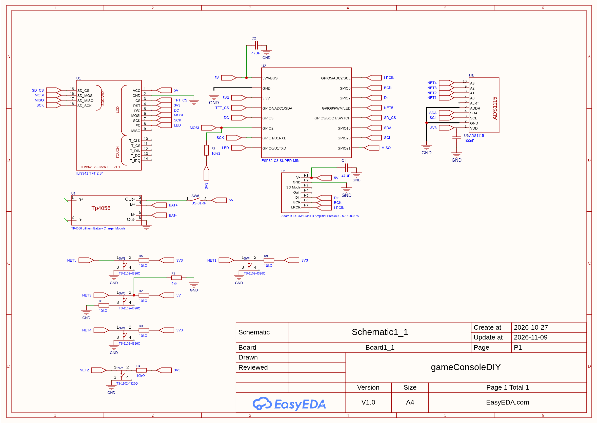

<div align="center">

# 🎮 ESP32-C3 Game Console

**A pocket-sized retro handheld you can build yourself.**
Ten games, a music and video player, and a polished pixel UI, all on an ESP32-C3.


<br>

           

</div>

---

## ✨ Highlights

- 🕹️ **10 games**, each with its own music, sound effects, pause menu and saved high scores
- 🧬 **Simulations**: Conway's Game of Life and an interactive Mandelbrot explorer
- 🎵 **Media**: music player and video player straight from the SD card, plus a camera viewer
- 🎨 **Polished UI**: phone-style launcher, 8 colour themes, light and dark mode, one shared UI kit for every screen
- 🔊 **Game music built in**: tracks are embedded in flash, no SD card needed to play
- ⚡ **Fast display**: 40 MHz SPI, about 29 full-screen frames per second
- 🧠 **RAM-smart**: big buffers exist only while their app is running

## 🕹️ What's inside

| | Apps |
| :--- | :--- |
| **Arcade** | Snake · Tetris · Breakout · Run · Galaga · Rally |
| **Puzzle & classic** | Sliding Puzzle · Tic-tac-toe · Pong · Minesweeper |
| **Simulations** | Conway's Game of Life · Mandelbrot explorer |
| **Media** | Music player · Video player · Camera viewer |
| **System** | Launcher · Settings · Info |

**Settings** cover theme, brightness, sound, effects volume, music volume, game music, battery saver and score reset.

## 🧰 Hardware

| Part | Details |
| :--- | :--- |
| 🧠 MCU | ESP32-C3 (`esp32-c3-devkitm-1`) |
| 🖥️ Display | ILI9341, 240×320 portrait, SPI at 40 MHz |
| 🎛️ Controls | D-pad through an ADS1115 ADC (I2C `0x48`) plus a Shoot button on a GPIO |
| 💾 Storage | SD card for music and video |
| 🔈 Audio | MAX98357A I2S amplifier and speaker |

### 🔌 Pinout

| Signal | GPIO | | Signal | GPIO |
| :--- | :---: | :---: | :--- | :---: |
| Display CS | 4 | | Shoot button | 8 |
| Display DC | 3 | | SD card CS | 9 |
| Display MOSI | 2 | | I2S BCLK | 6 |
| Display SCK | 1 | | I2S LRCLK | 7 |
| Display MISO | 21 | | I2S DOUT | 5 |
| Backlight | 0 | | I2C SDA | 10 |
| Display RST | 3V3 | | I2C SCL | 20 |

> The Shoot button is active-low with a 10k pull-up. Backlight is HIGH = on. Display pins live in `lib/TFT_eSPI/User_Setups/Setup70c_ESP32_C3_ILI9341.h`, the rest in `src/config.h`.

### 📐 Schematic

Drawn in EasyEDA (`gameConsoleDIY`, V1.0, updated 2026-11-09): ESP32-C3 Super Mini, ILI9341 display with SD slot, ADS1115 button reader, MAX98357A amplifier, TP4056 battery charger and six tactile switches.

[](docs/hardware/schematic.pdf)

Full-size files: [`schematic.png`](docs/hardware/schematic.png) · [`schematic.pdf`](docs/hardware/schematic.pdf)

## 🚀 Quick start

You need [PlatformIO](https://platformio.org/).

```sh
pio run                # build
pio run -t upload      # flash the console
pio device monitor     # serial monitor at 115200 baud
```

<details>
<summary><b>Flashing tips</b></summary>

- USB CDC on boot is on, so serial output comes over the native USB port.
- The partition table is `console_partitions.csv`.
- Close the serial monitor before flashing, otherwise the port is busy.
- `tools/flasher_gui.py` is a small point-and-click flasher.

</details>

## 🎛️ Controls

The same buttons do the same thing everywhere.

| Button | Action |
| :--- | :--- |
| ⬅️ ➡️ ⬆️ ⬇️ D-pad | Move, choose, change a value |
| 🔴 Shoot (tap) | Select or act |
| 🔴 Shoot (hold) | Pause or open options |

Every game's start card lists its exact controls.

## 🗂️ Project layout

```text
src/
├── gameConsoleNew.ino     entry point
├── game.h / game.ino      engine, input, high scores, countdown, tone task
├── menu.ino               launcher, Settings, Info
├── ui_kit.h / .cpp        shared ui:: helpers (cards, rows, pause sheets)
├── buttons.cpp            ADS1115 button scanning
├── audio_kit.*            sound effects and music helpers
├── sd_game_music.*        embedded game music
├── snake / tetris / breakout / run / galaga / sliding_puzzle / mini_games
├── rally.cpp  life.cpp  mandelbrot.cpp
└── music_player.cpp  video_player.cpp  camera_viewer.cpp
lib/TFT_eSPI/              customised display driver
assets/                    graphics, audio, generated data
tools/                     asset converters, flasher, music selector
tests/                     host-side tests
docs/                      audio and game-music notes
menu_preview/              menu-only preview firmware (separate project)
```

## 🛠️ Tools

| Tool | What it does |
| :--- | :--- |
| `tools/make_icons.py`, `tools/build_home_assets.py` | Rebuild launcher icons and wallpaper headers |
| `tools/select_game_music.py`, `tools/prepare_game_music.py` | Pick and convert embedded game music (see `docs/game-music.md`) |
| `tools/yt_to_console.py` | Turn a video into the `/videos/<name>/` layout (`video.mjpeg`, `audio.wav`, `info.txt`) |
| `tools/flasher_gui.py` | GUI flasher |

## ✅ Tests

Host-side tests live in `tests/` and cover audio, puzzle, rally, run, breakout, galaga and life. Tetris input checks:

```sh
python3 tools/check_tetris_input.py
python3 tools/check_tetris_controls.py
```

## 📝 Developer notes

- Keep new large buffers off static RAM; allocate them while the app runs.
- UI text uses TFT_eSPI fonts 2 and 4 only, so avoid characters they can't draw.
- Raising the SPI clock from 4 to 40 MHz took full-screen transfers from 3.2 to about 28.8 per second.
